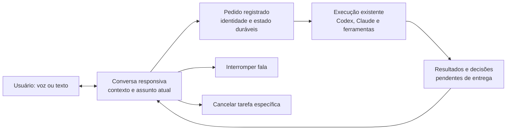

# Hey Jarvis: avaliação crítica da experiência, Dot e mercado

Data: 4 de novembro de 2026. Base de código examinada: `d77e155fc8270fe2456b1803832905b2203af183`.

## Parecer

O Hey Jarvis ainda não entrega uma experiência de assistente de voz confiável. O usuário precisa administrar o funcionamento do assistente: descobrir se ouviu, esperar sem saber o que aconteceu, entender a sessão de destino e procurar o resultado. Isso é uma falha de produto, mesmo quando cada componente possui testes.

A prioridade atual está invertida. Há um catálogo extenso de personalidades de voz, seleção de agente/modelo/esforço e vários controles de escuta, enquanto uma interação registrada hoje levou **86,434 segundos do recebimento do áudio ao primeiro áudio enviado pelo Hub**. Melhorar o timbre ou trocar o modelo principal, isoladamente, não resolve essa experiência.

Eu preservaria o núcleo de execução, os adaptadores de agentes e os mecanismos de contexto e recuperação. Redesenharia o contrato da experiência de voz: uma conversa disponível enquanto o trabalho acontece, com confirmação de recebimento, andamento verificável, interrupção clara e entrega recuperável. Não há evidência para justificar uma reescrita total do Jarvis.

## Método e limites

- Inspeção da interface real do aplicativo Windows: conversa, configurações de voz, timbres, continuação e diagnóstico do listener. Nenhum valor foi alterado.
- Leitura dos sete arquivos diários de log entre **29/10 e 04/11**, incluindo verificação de arquivos rotacionados desse intervalo: sete arquivos encontrados, 179 eventos selecionados pelo relatório de fluxo e quatro eventos `voice_turn`.
- Leitura integral do listener Windows, bridges de STT/TTS, fila e ponte de fala, comandos de fala, retenção de áudio, políticas de voz, continuação, acompanhamento de gravação e medição de turnos. Inspeção dos pontos de integração no Hub e no frontend. README, serviço de contexto pessoal e documentação de planejamento foram consultados por trechos pertinentes; isto não certifica toda a base nem todas as integrações.
- Consulta à documentação oficial dos produtos comparados, em 04/11/2026. Trata-se de comparação de capacidades documentadas e desenho de interação, sem teste comparativo de velocidade ou reconhecimento entre fornecedores.
- Duas reproduções adversariais de funções reais do listener, isoladas com entrada/saída simulada. Nenhum microfone, alto-falante, modelo ou serviço externo foi acionado nesses testes.
- Execução de 78 testes existentes de regras, fila, comandos e telemetria de voz: 78 aprovados, zero falhas ou testes ignorados.

Assumi que “Dot do Codex” se refere aos **dots da OpenAI**, que podem coordenar tarefas Work/Codex. A documentação oficial corresponde a essa descrição. Não observei a conta nem as conversas da esposa do usuário; a comparação não prova qual recurso explica a experiência dela.

O código em disco e os registros históricos não provam que todas as mudanças desse checkout estão carregadas no processo do Hub. Nenhum reinício foi feito nesta avaliação. Os logs provam incidentes naquele período; as reproduções provam o comportamento do código examinado.

## Evidência operacional

### Um turno de hoje levou 86,4 segundos até o envio da primeira resposta em áudio

O evento emitido em `2026-11-04T15:36:50.335Z` contém:

| Etapa | Tempo | Interpretação |
|---|---:|---|
| Transcrever | 3,737 s | O log de STT correspondente informa serviço já aquecido (`ensureMs: 0`) |
| Identificar falante | 0,882 s | Etapa anterior ao despacho |
| Corrigir/verificar transcrição | 8,849 s | Baixa confiança: `0.34`, política `balanced` |
| Total até despachar ao agente | 13,505 s | Inclui as três etapas anteriores; não deve ser somado a elas |
| Trabalho do agente | 61,034 s | O trabalho longo ocupa o caminho até a resposta |
| Preparar texto falado | 7,357 s | Houve resumo da resposta |
| Sintetizar primeiro trecho | 4,514 s | Antes do envio desse trecho |
| Receber áudio → enviar primeiro áudio | **86,434 s** | Medida do Hub, sem confirmação do primeiro som no aparelho |

É **um caso**, não uma mediana representativa. O horário de emissão do evento pode ser posterior ao envio, pois o tracker aguarda o relato do aparelho. Não há `perceivedMs` ou `stopToFirstAudioMs` nesse registro.

O usuário pode ter ouvido o bip de captura antes disso. Bip de captura, confirmação de tarefa aceita e resposta útil são marcos diferentes. Não seria honesto dizer que foram 86 segundos até qualquer som, nem contar um bip como resposta útil.

O fluxo explica o resultado: `runManagedTurn` aguarda `runAgentTurn`; depois chama `speak`. O Hub prepara/resume o texto e sintetiza trechos. Há divisão em trechos de áudio, mas esse caminho começa **depois da resposta do agente**, não enquanto o agente formula seus primeiros resultados. O mecanismo `ackThenWork` existe para alguns fluxos; sua própria documentação registra que não está integrado ao caminho geral de resposta do agente.

Referências: [turno compartilhado](../../packages/core/src/turn.ts), [integração do Hub: `speakReplyChunks`, `speechForReply`, `turnCtx`](../../apps/hub/src/index.ts), [confirmação antecipada](../voice-progressive-disclosure.md).

### Ativação, captura e transcrição não formam um funil confiável ainda

| Registro no intervalo | Quantidade / resultado |
|---|---|
| Detecções de wake word | 19 |
| Eventos de ausência de fala após ativação (`wake_flow:miss`) | 13 |
| Capturas, incluindo continuações | 23 |
| Capturas encerradas como `sem_fala` | 15 |
| Falhas de acompanhamento da gravação | 2, ambas `STT: tempo esgotado` |
| Turnos instrumentados | 4: dois `error`, um `ignored`, um `spoken` |
| STT nos dois turnos com erro | 60,100 s e 60,179 s |
| Registros de estado do microfone | 4.675 `ok`; 14.531 `silent` |

Os estados do microfone são registros repetidos, **não duração de indisponibilidade**. As 13 ausências de fala não demonstram 13 falsos positivos: podem envolver silêncio intencional, microfone, VAD ou outros fatores. Também não se deve dividir quatro turnos por 19 ativações para anunciar uma taxa de sucesso: há continuações e caminhos que enviam texto após STT local, fora da mesma instrumentação.

Na inspeção atual, a UI mostrou listener conectado e armado, usando o Logitech G933 como reserva porque a webcam estava sem sinal. Logo, seria errado dizer que o listener simplesmente não existe ou está sempre offline. O diagnóstico existe, mas fica escondido nas configurações avançadas.

Referências: [relatório de fluxo](../../scripts/voice-flow-report.mjs), [relatório de turnos](../../scripts/voice-report.ts), [política de medição](../../packages/core/src/voice-turn.ts).

## Achados e consequências

### 1. Crítico: a conversa espera pelo agente de execução

**Comprovado por código e pelo turno de 86,4 s.** A soma de transcrição, eventual correção por outro modelo, agente, resumo e síntese cria esperas em série. Mesmo eliminar integralmente a transcrição não resolveria o minuto consumido pelo trabalho do agente nesse caso.

**Correção de produto:** manter uma camada de conversa capaz de receber esclarecimentos, informar o que está executando e continuar disponível enquanto uma tarefa independente trabalha. Pedidos curtos precisam de um caminho curto; trabalhos longos precisam de recibo e acompanhamento. O recibo deve indicar uma tarefa realmente registrada, e não uma promessa genérica pronunciada antes de confirmar que a execução começou.

**Preservar:** STT/TTS aquecidos, síntese em trechos, filtro de relevância condicional e comandos determinísticos já implementados. Não propor essas mesmas funcionalidades como novidades. Medir quanto cada caminho custa no hardware real antes de trocar a stack inteira.

### 2. Crítico: o listener pode esconder falhas de envio e reprodução

**Reproduzido em funções reais, com I/O simulado:**

- Em `send_utterance`, `_hub_send` pode devolver `False`, mas o retorno é ignorado, a mensagem de log afirma que a fala foi enviada e o fluxo prossegue. O `True` dessa função significa que não houve recusa local; não comprova entrega. No listener examinado não há tratamento de `voice_ack`/`voice_failed` que feche esse ciclo como existe no cliente web.
- `play_wav_b64` captura a falha da saída de som e retorna normalmente. `play_one` então emite `tts_played`, mesmo quando a reprodução simulada falhou.

**Consequência:** o usuário pode ficar sem resposta e o sistema avançar como se tivesse cumprido sua parte. A recuperação do Hub não resolve um pedido que nunca chegou a ele.

**Correção:** contrato explícito para recebido, persistido, processado, áudio iniciado, áudio concluído e falha; confirmação vinculada ao mesmo pedido; reenvio idempotente; mensagem de falha acionável. A fila deve ser liberada em uma falha de áudio, mas com resultado `error`, sem contabilizar reprodução bem-sucedida. Simplesmente remover o ACK pode deixar a fila presa.

Referência: [listener: `on_message`, `send_utterance`, `play_wav_b64`, `play_one`](../../services/voice/wake_listener.py). Reprodução privada: `~/.jarvis/evidence/2026-11-04-hey-jarvis-review/reproduce-listener-failures.py`.

### 3. Alto: timeout e retentativa não têm um orçamento de conversa

O STT possui timeout de 60 s por pedido. O caminho atual do Hub permite uma segunda tentativa automática, além do tempo de inicialização do serviço. O bridge da síntese em nuvem usa `fetch` sem um prazo explícito de cancelamento nessa função. Isso não prova que a nuvem causou o caso observado, mas deixa a experiência sem um limite de espera controlado nessa camada.

**Correção:** prazo curto para informar degradação, prazo total por etapa, cancelamento propagado e recuperação em segundo plano quando fizer sentido. Preservar a gravação conforme a escolha do usuário e oferecer “tentar novamente”/“editar texto”. O produto não pode responder a uma falha transitória com silêncio por um ou dois minutos.

Referências: [STT](../../apps/hub/src/stt.ts), [TTS](../../apps/hub/src/tts.ts), [tratamento de `voice` no Hub](../../apps/hub/src/index.ts), [armazenamento de áudio existente](../../apps/hub/src/voiceAudio.ts).

### 4. Alto: a interface transfere decisões de engenharia ao usuário

O painel real começa com IA da voz, modelo, esforço, modo rápido e catálogo de timbres. Continuação, fim de fala, retenção, wake word e estado do microfone aparecem depois de rolar bastante. O catálogo mistura perfis de personalidade, idiomas, vozes-base e opção local. A configuração de escuta expõe segundos e políticas de checagem por IA.

Essa flexibilidade serve ao operador técnico, mas é um começo ruim para alguém que só quer conversar. Na máquina inspecionada, “falar respostas por padrão” e continuação do cliente estavam desligados. O listener tem configurações próprias: isso **não significa** que o wake esteja sem resposta falada, pois ele envia `speak: True` e tem sua própria continuidade.

**Correção:** uma entrada principal “Conversar com Jarvis”, microfone ativo e saída audível visíveis, estado claro, assunto atual e tarefas em andamento. Nas preferências básicas: idioma, voz, dispositivo e privacidade. Modelos, esforço, thresholds e tamanho de retenção ficam em opções avançadas. Ditado para o campo de texto e conversa com resposta falada devem ser ações distinguíveis.

Referência: [painel de voz](../../apps/hub/web/index.html), além da inspeção visual Windows. A proposta é reorganização e bons padrões, não remover a possibilidade de configuração técnica.

### 5. Alto: interrupção e continuidade existem, mas ainda não equivalem a conversa fluida

O listener já interrompe a fala ao detectar **“Hey Jarvis”**, usando limiar maior enquanto há áudio. Também abre janelas de resposta e aceita continuações. Portanto, “implementar interrupção” seria um diagnóstico incompleto.

A limitação é o contrato: repetir a palavra de ativação para interromper não é o mesmo que poder dizer naturalmente “espera, quis dizer o outro projeto”. O listener interrompe uma captura de continuação quando a resposta começa a tocar, para não transcrever a própria voz. Isso evidencia o compromisso acústico atual. Não validei cancelamento de eco no ambiente real.

**Correção:** escolher explicitamente entre conversa contínua, com detecção de fala e controle de eco validados, e um modo de turnos simples e previsível. Separar “pare de falar”, “cancele esta tarefa” e “encerre a conversa”. A fila já tem parte dessa separação; a interface precisa torná-la compreensível. Testar destino da continuação com duas sessões concorrentes, não apenas um diálogo vazio.

Referências: [listener](../../services/voice/wake_listener.py), [fila](../../apps/hub/src/speechQueue.ts), [comandos](../../apps/hub/src/speechCommands.ts), [continuação por agente](../../apps/hub/src/voiceContinuation.ts).

### 6. Alto: histórico salvo e resultado entregue são garantias diferentes

As correções de histórico e atividade tratadas nesta sessão são necessárias. O usuário, porém, precisa reencontrar **o pedido, o estado real e o resultado** depois de uma queda. Há execução persistida, histórico e mecanismos de reenvio no projeto; seria errado diagnosticar ausência total de persistência.

A fila de fala e o tracker de voz examinados mantêm seu estado em memória. Um registro `spoken` começa no envio do áudio pelo Hub, mesmo sem retorno do aparelho. A amostra analisada não contém confirmação de primeiro som. É preciso reconciliar entrega com as tarefas persistidas, não usar a existência de uma mensagem ou o fim de um processo como prova de que o dono recebeu o resultado.

**Correção:** caixa de resultados pendentes, com “concluído”, “aguardando você”, “falhou” e “interrompido”; ao reconectar, retomar a informação e perguntar se o usuário quer ouvir. Evitar reproduzir automaticamente uma fila velha inteira. Reutilizar o armazenamento e a identidade de execução existentes.

Referências: [incidente de recuperação de histórico](../reports/INC-07-historico-interrompido-codex-claude.md), [ponte da fala](../../apps/hub/src/speechBridge.ts), [tracker](../../packages/core/src/voice-turn.ts).

### 7. Alto para confiança: a retenção não cobre todas as cópias de áudio

`pcm_to_wav` cria `jarvis_wake_*.wav` no diretório temporário para identificar o falante e eventualmente transcrever. O listener examinado não remove esses arquivos. A busca das referências desse nome no código não encontrou limpeza. Havia **nove arquivos, 7.017.356 bytes**, com modificações entre 28/10 e 04/11. Somente metadados foram inspecionados; o áudio não foi ouvido.

Essas cópias ficam fora do `VoiceAudioStore`, embora a interface ofereça “só até transcrever”. O problema principal aqui é a coerência da retenção, não o volume de disco nessa amostra.

**Correção:** limpar temporários em `finally` e cobrir recuperação de restos após queda com a política definida. Uma retenção voluntária para diagnóstico precisa ser separada da cópia temporária de processamento. Não apagar os arquivos existentes silenciosamente durante uma análise.

### 8. Estratégico: muitas capacidades ainda não formam uma responsabilidade contínua

O Jarvis tem contexto pessoal, preferências, consentimentos, fontes, agenda, ações, rotinas e notificações no código. O próprio painel tem uma área de assistente pessoal. A questão não é contar conectores ou criar mais um módulo de memória.

O critério deve ser uma tarefa real: “acompanhe este trabalho, aceite esta correção enquanto executa, lembre o que já foi decidido e traga o resultado quando precisar de mim”. A experiência atual privilegia sessões, agentes e configurações. Minha avaliação de produto é que falta concentrar essa capacidade em poucas jornadas coerentes e verificadas.

O escopo inicial deve seguir o uso já demonstrado: acompanhar desenvolvimento, corrigir uma instrução em andamento, consultar resultados e recuperar trabalho interrompido. Funções pessoais podem crescer a partir de jornadas específicas; ampliar catálogo de funções agora aumenta a superfície que o usuário precisa entender e a equipe precisa manter.

## O que aprender com Dot e com o mercado

Comparação por categoria de uso. As linhas não são um ranking de precisão, velocidade, preço ou disponibilidade universal.

| Referência | Experiência documentada relevante | Lição para Jarvis | Limite da comparação |
|---|---|---|---|
| OpenAI dots | Responsabilidades contínuas, tarefas delegadas, resultados e contexto entre interações | A conversa coordena trabalho; o usuário pode voltar e continuar orientando | Disponibilidade gradual; trabalho local depende do computador conectado |
| Voice no ChatGPT/Codex | Conversa com interrupção e acompanhamento de tarefas enquanto elas trabalham | Separar conversa responsiva da execução longa | Documentação de capacidade, não medição na máquina do usuário |
| Gemini Live | Conversa interrompível, câmera/tela opcionais e transcrição consultável | Correção no meio da fala e passagem entre voz e texto fazem parte do fluxo principal | A página examinada trata de Android; não demonstra paridade com Windows |
| Microsoft Copilot / Hey Copilot | Palavra de ativação abre controles de conversa; detecção local e estados de início/fim | O wake é uma porta de entrada para uma experiência explícita | Precisa do app/internet; há restrições de tela bloqueada e áudio de outro app |
| Wispr Flow | Ditado no campo em uso, acionado por atalho e revisado antes de enviar | Uma tarefa estreita com entrada e saída fáceis de entender | Ditado não equivale a assistente autônomo; transcrição requer internet |
| Home Assistant Voice | Processamento local ou nuvem, controles físicos e sinalização do estado de áudio | Operação local é viável, mas acústica, hardware e escopo fazem parte do produto | Comandos locais focados e fala aberta têm exigências diferentes |

Fontes: [dots](https://learn.chatgpt.com/docs/dots), [tarefas e memória](https://learn.chatgpt.com/docs/dots/tasks-and-memory), [Voice](https://learn.chatgpt.com/docs/features/voice), [Gemini Live](https://support.google.com/gemini/answer/15274899?hl=en-BA), [Hey Copilot](https://support.microsoft.com/en-au/microsoft-365-copilot/how-hey-copilot-wake-word-works-in-microsoft-365-copilot), [Wispr Flow](https://docs.wisprflow.ai/articles/2772472373-what-is-flow), [Home Assistant Voice](https://www.home-assistant.io/voice-pe/).

Minha inferência a partir dessas referências: o padrão de comparação deve ser **continuidade, controle e fechamento da tarefa**, além da qualidade de voz. Uma animação atraente e uma voz mais natural não compensam pedidos perdidos ou um assistente indisponível durante o trabalho.

O Dot também não deve ser idealizado: sua documentação distingue parar o agente principal, parar trabalhos delegados e cancelar agendamentos. Ela também alerta que uma execução encerrada não comprova entrega do objetivo. Jarvis pode melhorar justamente a clareza dessas diferenças. [Controles do Dot](https://learn.chatgpt.com/docs/dots/controls), [revisão de tarefas](https://learn.chatgpt.com/docs/dots/tasks-and-memory).

## Três caminhos tecnicamente defensáveis

| Caminho | Ganho | Custo e consequência ruim | Quando escolher |
|---|---|---|---|
| A. Consolidar o fluxo atual, focado em comandos e push-to-talk | Menor mudança; preserva processamento local; entrega mais previsível | Naturalidade limitada; pode continuar distante da expectativa criada pelo Dot | Se o objetivo principal for ditar comandos e receber status |
| B. Camada de conversa independente + execução durável existente | Permite conversar, corrigir e acompanhar sem esperar o agente terminar | Mais um subsistema; integração de contexto, latência, custo e privacidade precisam de limites explícitos | Se o objetivo for um assistente cotidiano comparável à referência citada |
| C. Usar um produto de mercado como interface e manter Jarvis especializado em execução | Reduz investimento em uma experiência de voz própria | Dependência de fornecedor, disponibilidade e permissões; integração com Jarvis ainda precisa ser comprovada | Se o valor estiver no resultado e não em possuir a interface de voz |

**Recomendação:** corrigir os defeitos concretos de A como base de confiabilidade e validar uma fatia pequena de B antes de expandir. Um protótipo deve demonstrar conversa + tarefa longa + interrupção + recuperação. Se não superar A nesse teste ou o custo de operação for injustificável, optar por A ou C é melhor que manter um assistente ambicioso e frágil.

Não recomendo uma troca de provedor ou API específica sem benchmark no Windows utilizado. B pode usar um mecanismo de fala em tempo real ou uma composição local otimizada; a separação entre conversa e execução é a decisão central. A compatibilidade de C é uma hipótese de integração, não uma capacidade já comprovada.



## Ordem de trabalho e critérios de aceite

### P0 — Fazer o contrato básico ser verdadeiro

1. Fechar ACK/reenvio/erro no listener, com idempotência e confirmação de persistência no Hub. Não chamar de enviado o que falhou.
2. Distinguir reprodução iniciada, concluída e falha, mantendo a fila capaz de avançar. Instrumentar primeiro som no listener, não somente no navegador.
3. Aplicar orçamento de espera às dependências; informar falha cedo e preservar tentativa recuperável segundo a política de áudio.
4. Unificar a retenção de todas as cópias temporárias e cobrir encerramento inesperado.
5. Colocar estado do microfone/saída/serviço junto da entrada de voz; permitir diagnóstico guiado e escolha compreensível do dispositivo.
6. Comprovar recuperação de pedido e resultado após reinício em ambiente isolado. Aguardar trabalhos ativos para qualquer reinício do serviço real, conforme a decisão do usuário nesta sessão.

**Aceite:** nenhum cenário de falha testado vira silêncio sem estado ou sucesso falso; reenvio não duplica execução; tarefa aceita sempre é reencontrada; áudio descartado obedece à configuração. Um teste real de ouvir/falar precisa complementar os testes de protocolo.

### P1 — Fazer conversar ser mais simples que operar o painel

1. Uma entrada clara para conversa, distinta de ditado, com assunto e tarefa atuais visíveis.
2. Trabalhos longos independentes do ciclo de fala. A conversa continua aceitando correções e consultando status real.
3. Resposta curta e útil por padrão; detalhes e artefatos ficam disponíveis em texto. Evitar resumir por outro modelo antes de toda primeira resposta.
4. Interrupção, cancelamento e encerramento com semântica explícita; continuidade correta entre sessões e aparelhos.
5. Configurações básicas pequenas e configurações técnicas avançadas. Manter escolha de voz sem deixar o catálogo esconder o diagnóstico.

**Aceite:** concluir as cinco jornadas abaixo sem precisar selecionar agente/modelo/esforço durante o uso normal; demonstrar que falar uma correção não a perde nem a envia ao trabalho errado.

### P2 — Dar valor contínuo com contexto e entrega

1. Caixa de tarefas e resultados com origem, estado, última atualização e decisão pendente; integrar o histórico recuperado.
2. Memória de decisões e responsabilidades com fonte e possibilidade de correção. Reutilizar o contexto existente e testar recuperação relevante, em vez de anexar indiscriminadamente todo o histórico.
3. Notificações apenas quando ajudam a decidir ou agir; resumo ao voltar, deduplicação e controle de interrupções.
4. Expandir fontes e automações uma jornada por vez, com critérios explícitos de utilidade e permissão.

**Aceite:** o usuário encerra a conversa, volta depois, encontra resultado e decisões, e consegue continuar sem reconstruir o contexto manualmente. Tarefa interrompida aparece como interrompida, nunca como concluída só porque o processo encerrou.

## Como medir “ficou decente”

Metas iniciais propostas para o protótipo, **não benchmarks publicados nem garantias de que a stack atual as alcança**:

| Medida | Meta proposta | Como evitar uma métrica enganosa |
|---|---|---|
| Feedback de captura após acionamento aceito | Até 300 ms | Não contar como resposta útil |
| Resposta útil para pergunta simples, após fim da fala | Mediana até 1,5 s; p95 até 3 s | Medir primeiro som no aparelho e qualidade da resposta |
| Confirmação de trabalho longo | Até 3 s após fim da fala | Só confirmar aceitação durável, com tarefa identificável |
| Interromper áudio por botão | Até 250 ms após acionamento | Medir saída de som, não apenas emissão de evento |
| Interrupção por voz | Medir separadamente, com alvo inicial até 500 ms após reconhecimento da intenção | Incluir ruído, eco e falsos acionamentos; não confundir tempo de falar a frase com latência de reação |
| Integridade | Zero pedidos aceitos perdidos e zero execuções duplicadas nos cenários de falha | Verificar persistência e efeito real, não apenas texto da UI |
| Sucesso de jornada | Pelo menos 95% em 100 tentativas controladas | Relatar contagem, condição e incerteza; isso ainda não prova confiabilidade de longo prazo |

Cinco jornadas: pedido curto de status; delegação longa com conversa simultânea; correção enquanto fala; consulta de resultado de outro projeto; retomada após queda.

Executar 20 tentativas por jornada, distribuídas entre headset e webcam, silêncio e ruído controlado, sessão vazia e sessão com histórico. Incluir nomes de projetos em português, pausa para pensar, mudança de assunto, saída de áudio indisponível, queda de rede, timeout de STT, duas tarefas concorrentes e reinício isolado do Hub. Manter casos de autorização para que “ficar rápido” não signifique executar ações sem autorização.

Para wake word, usar conjunto rotulado de ativações intencionais e período de fala ambiente sem ativação intencional. Medir omissões e falsos acionamentos por hora separadamente. Os logs atuais não fornecem esse denominador. Fixar a meta de wake depois desse baseline, sem inventar uma taxa de acerto a partir do score do modelo.

Também medir custo por conversa bem-sucedida, consumo de CPU/RAM/GPU, tempo de manutenção e dependência de rede. Um ganho de voz que torne o computador instável ou excessivamente caro não passa no aceite.

## O que manter, simplificar e suspender

**Manter:** execução independente de agente; integração com repositórios locais; histórico e journal de execução; contexto pessoal e consentimentos; fila única de áudio; políticas determinísticas; opção local; testes de regras; recuperação já implementada.

**Simplificar:** a entrada de conversa; catálogo de voz; escolha cotidiana de modelo/esforço; localização de diagnóstico; quantidade de estados e termos técnicos expostos ao dono.

**Suspender como prioridade de desenvolvimento:** novas personalidades de voz, mais provedores sem necessidade demonstrada, expansão de funções pessoais desconectadas de uma jornada e ajustes de wake sem amostra rotulada. Não é uma proposta de apagar funcionalidades sem análise de uso.

**Abandonar como critério de conclusão:** “o processo está online”, “o áudio foi enviado”, “a suíte passou” e “o usuário consegue configurar” como substitutos de uma interação efetivamente concluída.

## Validação e arquivos produzidos

Comandos executados para esta avaliação:

```text
node scripts/voice-flow-report.mjs --days 7
python C:\Users\Jonathan\.jarvis\evidence\2026-11-04-hey-jarvis-review\reproduce-listener-failures.py
node --env-file=scripts/test.env --import tsx --test --test-concurrency=2 scripts/voice-flow-report.test.mjs packages/core/src/voice-turn.test.ts packages/core/src/voice-policy.test.ts packages/core/src/voice-endpoint.test.ts apps/hub/src/speechQueue.test.ts apps/hub/src/speechBridge.test.ts apps/hub/src/speechCommands.test.ts
```

Resultado: relatório com 179 eventos; dois caminhos de falha reproduzidos; 78 testes existentes aprovados. O script de reprodução verifica o comportamento defeituoso observado, não afirma que esse comportamento está correto.

Evidência privada em `~/.jarvis/evidence/2026-11-04-hey-jarvis-review/`:

- `voice-evidence.json`: agregados, os quatro eventos de turno sem transcrições, arquivos/datas examinados e metadados de temporários.
- `reproduce-listener-failures.py` e `reproduction-result.txt`: reprodução sem acesso a dispositivos.
- `voice-unit-tests.txt`: saída dos 78 testes.

Nenhum teste acústico com usuário, teste comparativo em conta de fornecedor, reinício real ou alteração de implementação foi feito. A implementação dos ajustes e o aceite de produto permanecem trabalho futuro. Este relatório é o resultado da análise solicitada.
